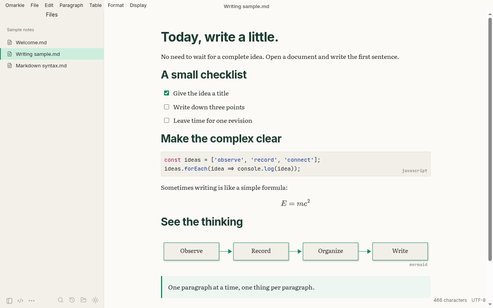
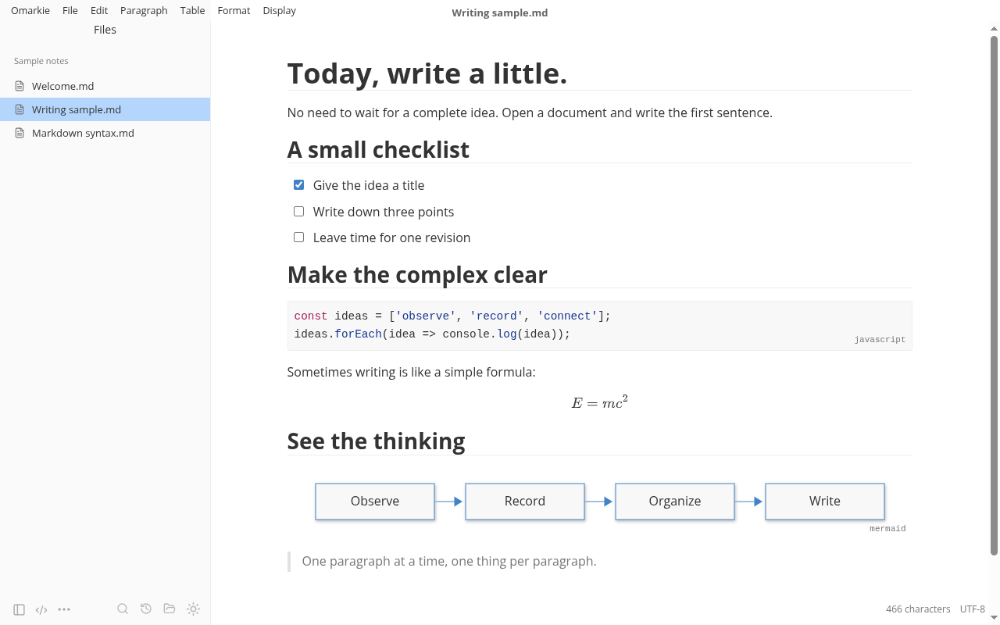
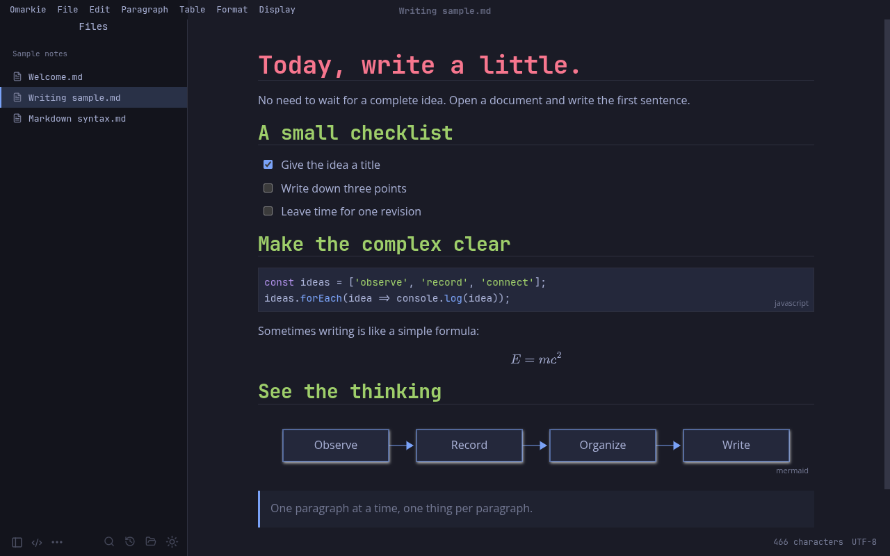
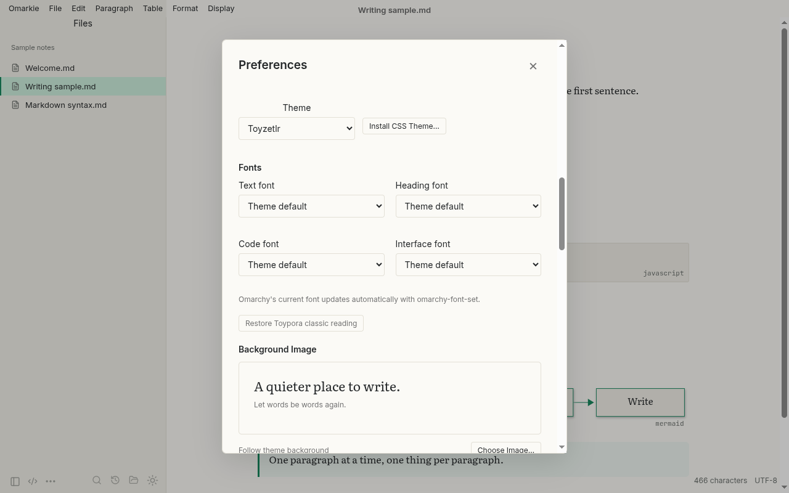

<p align="center">
  
</p>

<h1 align="center">Omarkie</h1>

<p align="center">Write in Markdown. Work directly on the page. Keep your files.</p>

<p align="center">
  <a href="https://github.com/gafgpt-cmd/omarkie/releases/latest">Download</a> · <a href="#features">Features</a> · <a href="#themes-and-fonts">Themes and fonts</a> · <a href="CONTRIBUTING.md">Contributing</a> · <a href="LICENSE">MIT License</a>
</p>



Omarkie is an open-source Markdown editor with live, inline rendering. Write directly in the formatted document, switch to source when you need it, and keep ordinary `.md` files in your own folders. It feels at home on [Omarchy](https://omarchy.org): it follows your Omarchy theme and font live, and it runs on Linux, Windows and macOS.

**Status:** early development, version **0.1.0**. The interface is available in English, Spanish, Catalan, Romanian and Chinese.

## Features

- **Live Markdown editing**: headings, inline formatting, lists, tasks, tables, links, footnotes and YAML front matter. Edit code and formulas in place, or switch to the full source view.
- **Themes and fonts**: 17 built-in themes, including Toypora, Toyzetlr and live Omarchy themes, plus pickers for the text, heading, code and interface fonts. The fonts are bundled, so documents look the same on any machine.
- **Omarchy integration**: themes follow the current Omarchy palette and font, and update while the app is open when you run `omarchy-theme-set` or `omarchy-font-set`. Under Omarchy, Omarkie uses the Omarchy theme until you choose another theme yourself.
- **A focused writing space**: menu bar, outline, focus and typewriter modes, word counts, find and replace, and personal background images.
- **Works with Typora themes and plugins**: install Typora-style CSS themes, and use eight bundled community plugins or your own ([compatibility scope](docs/plugins.md)).
- **Files you control**: folder tree, full-text search, quick open, recent files, autosave, session recovery and external-change conflict detection.
- **Private by default**: remote images and embeds are blocked until you allow them, so opening a note never contacts other servers.
- **Images, math and diagrams**: local and pasted images, offline MathJax, Mermaid and a [legacy sequence/flow subset](docs/diagrams.md). Optional uploads through a configured PicGo Server.
- **More than UTF-8**: UTF-16 LE/BE, GB18030, GBK, Big5, Shift JIS and Windows-1252, with BOM and line endings preserved.
- **Import and export**: HTML and PDF built in; DOCX, ODT, RTF, EPUB and more through [Pandoc](https://pandoc.org/).

## Themes and fonts

| Theme | Colors | Fonts |
| --- | --- | --- |
| **Toypora** / **Toypora Night** | Classic white page / soft night | Open Sans, 16 px, line height 1.6, 860 px column |
| **Toyzetlr** / **Toyzetlr Night** | Warm paper, green accents | Literata text, Inter headings and interface, JetBrains Mono code |
| **Omarchy** | Your live Omarchy palette | Your Omarchy font for text, headings, code and interface |
| **Omarchy × Toypora** | Your live Omarchy palette | Toypora's classic reading fonts |
| **Toypora × Omarchy** | Toypora's classic colors | Your Omarchy font, Liberation Sans text |

Under **Preferences → Fonts**, choose the text, heading, code and interface fonts independently: Open Sans, PT Serif, Merriweather, Lato, Vollkorn, Literata, Inter, JetBrains Mono, Liberation Sans and Serif, your current Omarchy font, or the system fonts. **Restore Toypora classic reading** brings back the classic set in one click.

| Toypora | Omarchy | Fonts |
| --- | --- | --- |
|  |  |  |

## Install

Download the package for your platform from [Releases](https://github.com/gafgpt-cmd/omarkie/releases/latest) and check it against `SHA256SUMS.txt`.

### Linux

| Distribution | Package | Install |
| --- | --- | --- |
| Arch, Omarchy, Manjaro | `omarkie-0.1.0-1-any.pkg.tar.zst` | `sudo pacman -U ./omarkie-0.1.0-1-any.pkg.tar.zst` |
| Debian, Ubuntu, Mint | `Omarkie-0.1.0-linux-x64.deb` | `sudo apt install ./Omarkie-0.1.0-linux-x64.deb` |
| Fedora, RHEL, openSUSE | `omarkie-0.1.0-1.x86_64.rpm` | `sudo dnf install ./omarkie-0.1.0-1.x86_64.rpm` |
| Any x64 distribution | `Omarkie-0.1.0-linux-x64.AppImage` | `chmod +x` the file and run it |

The Arch package is small (about 14 MB) because it runs on Arch's shared Electron runtime instead of bundling one: when built on a machine that already has an Electron series from 43 up (for example the one Obsidian uses), the newest of those, so the system keeps a single runtime; otherwise the recommended `electron44` it is built and tested with (`OMARKIE_ELECTRON=electron44 npm run package:arch` picks one explicitly). pacman installs the runtime automatically, and if it is ever removed, `omarkie` says so and offers to reinstall it. The other packages bundle their own runtime. All packages add the launcher and the Markdown file association; removing them keeps your documents and recovery data. The AppImage may need FUSE 2; without it, run `./Omarkie-0.1.0-linux-x64.AppImage --appimage-extract` and then `./squashfs-root/AppRun`. Do not disable Chromium's sandbox to run the application.

#### Update, uninstall and clean up

To update, install the new package over the old one with the same command as above. There is no need to remove the old one first, and a rebuilt package with the same version number also replaces the installed one.

| | Arch, Omarchy, Manjaro | Debian, Ubuntu, Mint | Fedora, RHEL, openSUSE |
| --- | --- | --- | --- |
| Which build is installed | `pacman -Q omarkie` | `dpkg -s omarkie` | `rpm -q omarkie` |
| Uninstall | `sudo pacman -R omarkie` | `sudo apt remove omarkie` | `sudo dnf remove omarkie` |
| Remove the unused Electron runtime too | `sudo pacman -Rs omarkie` | not needed (bundled) | not needed (bundled) |

A release build is named after its version (`0.1.0`). An Arch package built from a later commit is named `0.1.0.r<commits>.g<commit>`, for example `0.1.0.r3.gdcb6c9e`, so `pacman -Q omarkie` shows which build you have, and pacman treats it as newer than the release. `-Rs` keeps the Electron runtime if another application, such as Obsidian, still needs it.

Uninstalling never touches your documents. Settings, recovery drafts, installed themes and plugins, and the background image stay in `~/.config/Omarkie`. Move that folder to the Trash to remove them as well, or to reset Omarkie to its defaults; unsaved drafts in it are lost. For the AppImage, delete the file.

### Windows

Run **Setup.exe**, choose a folder and launch Omarkie from the Start menu. The installer adds an optional desktop shortcut and Markdown file associations. The build is not code-signed yet, so Windows may show an unknown-publisher notice; only use downloads from this repository.

### macOS

Open the DMG and drag **Omarkie** into **Applications**. Requires macOS 14 or later on Apple Silicon. The app is locally signed and not notarized, so macOS may ask you to approve it in **System Settings → Privacy & Security**.

### Optional converters

Install [Pandoc](https://pandoc.org/installing.html) for DOCX, ODT, EPUB and other formats; select its executable in Preferences if it is not detected. On Linux and Windows, legacy DOC/RTF import also needs [LibreOffice](https://www.libreoffice.org/download/download-libreoffice/).

## Build from source

Use **Node.js 26** and npm.

```sh
git clone https://github.com/gafgpt-cmd/omarkie.git
cd omarkie
npm ci
npm run package:linux   # DEB, RPM and AppImage in release/linux/
npm run package:arch    # Arch package on the shared Electron runtime, in release/arch/ (needs makepkg)
npm run package:win     # on Windows x64: installer and ZIP in release/windows/
npm run package:mac     # on macOS with Xcode Command Line Tools: release/native/Omarkie.app
```

## First steps

Open a Markdown file or a folder, or start from the sample notes. Click the text to edit it. Enter continues a list or creates a paragraph; Tab moves through table cells.

| Action | Linux / Windows | macOS |
| --- | --- | --- |
| New document | `Ctrl+N` | `⌘N` |
| Open a file | `Ctrl+O` | `⌘O` |
| Save | `Ctrl+S` | `⌘S` |
| Preferences | `Ctrl+,` | `⌘,` |
| Toggle source view | `Ctrl+/` | `⌘/` |
| Find in the document | `Ctrl+F` | `⌘F` |
| Search the folder | `Ctrl+Shift+F` | `⌘⇧F` |
| Quick open | `Ctrl+P` | `⌘⇧O` |

## Development

```sh
npm ci
npm run dev:app   # Vite + Electron
npm test          # editor and file-layer unit tests
npm run build     # type check and production build
```

Linux and Windows use Electron; the macOS release uses a native Swift/AppKit host with WKWebView. Both share the same TypeScript/React interface and editing model. Desktop suites, packaging and the project layout are described in [CONTRIBUTING.md](CONTRIBUTING.md) and [the architecture](docs/architecture.md).

## Current limitations

- Documents are limited to 20 MB. Files over 12,000,000 characters, or with a single block over 256,000 characters, open in source mode.
- Legacy encodings without a BOM need an explicit encoding choice.
- Rich and source editing keep separate undo histories; source changes join the rich history as one step when you switch back.
- Format conversion can change layout. Keep the original file when importing.
- Third-party themes, plugins, input methods and image hosts vary in compatibility.

## Contributing

Bug reports, focused fixes and reproducible examples are welcome. Start with [the contribution guide](CONTRIBUTING.md), then open an [issue](https://github.com/gafgpt-cmd/omarkie/issues) or a pull request.

## License

[MIT](LICENSE). Bundled fonts (Open Sans, PT Serif, Merriweather, Lato, Vollkorn, Literata, Inter, JetBrains Mono, Arimo, Tinos) are under the SIL Open Font License; MathJax and its fonts use Apache-2.0. Third-party dependencies keep their own licenses, and the packaged application includes their notices.
