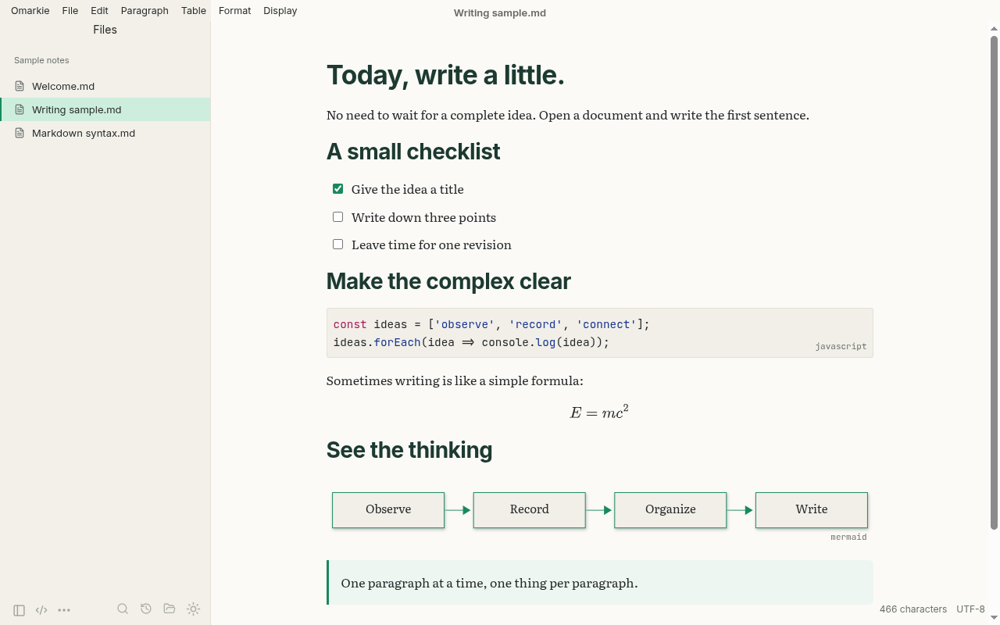
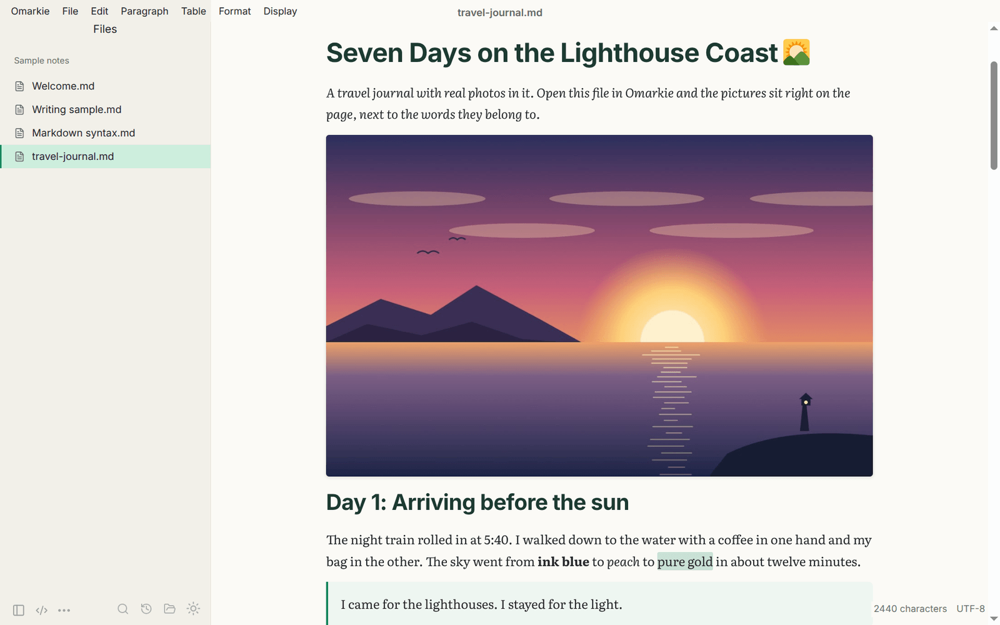
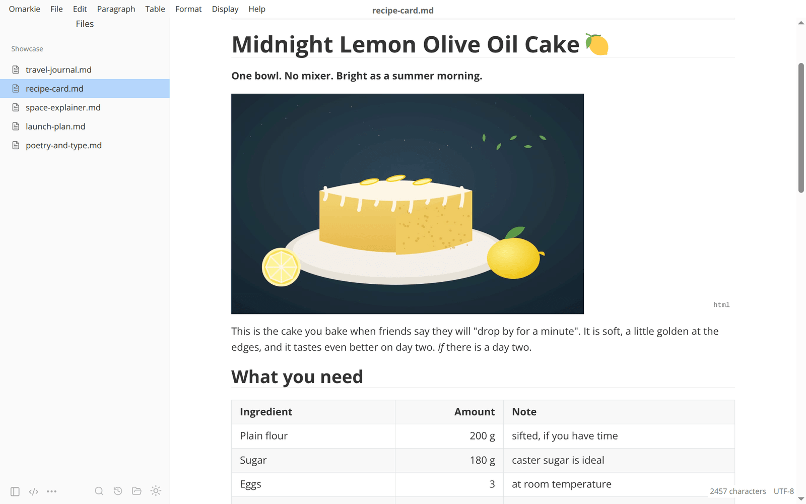
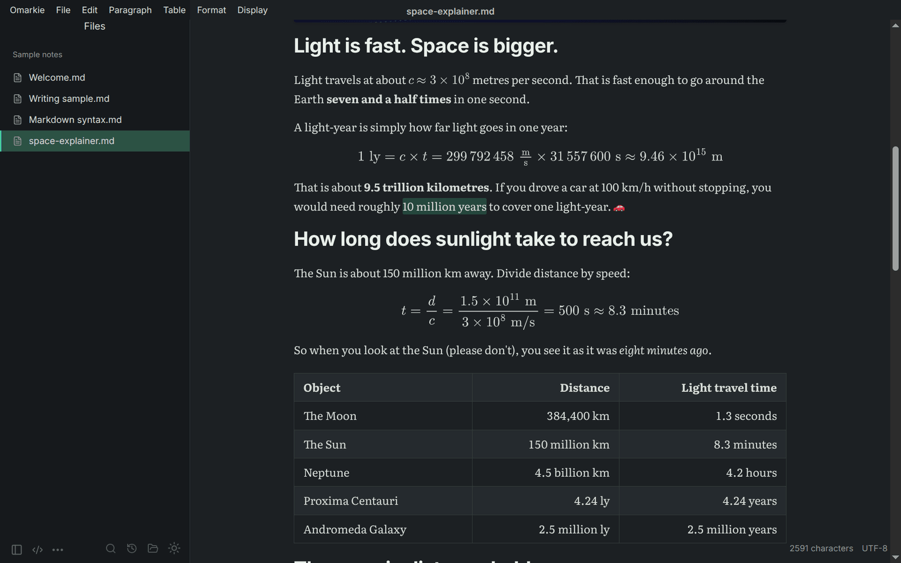
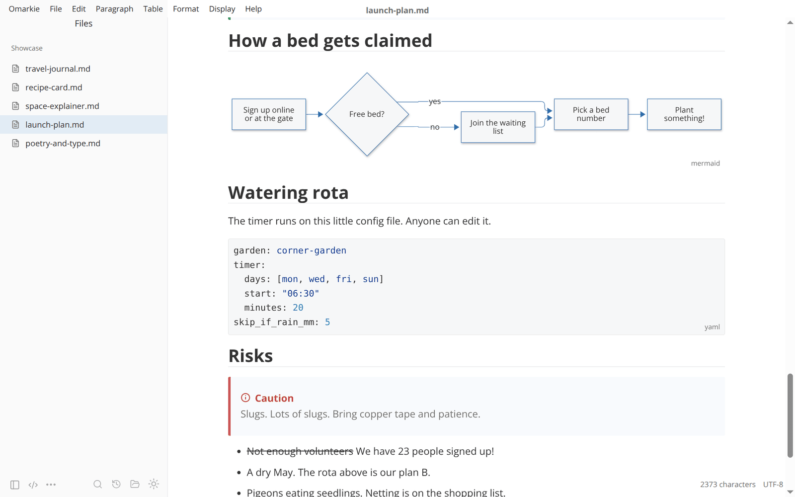
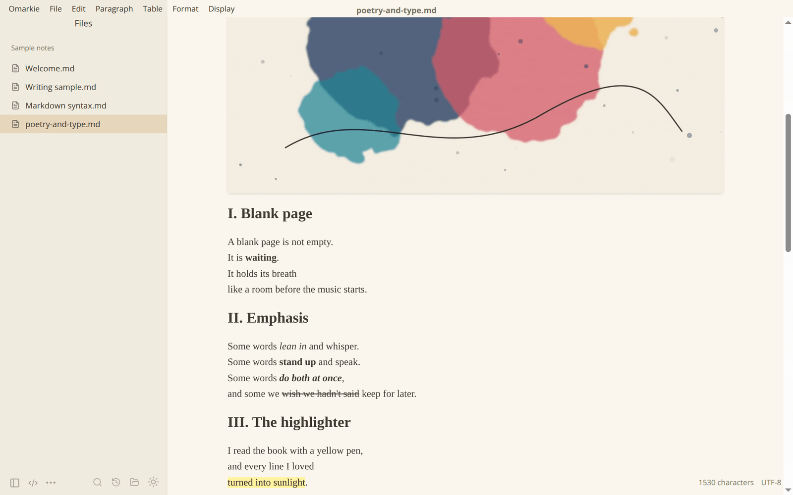
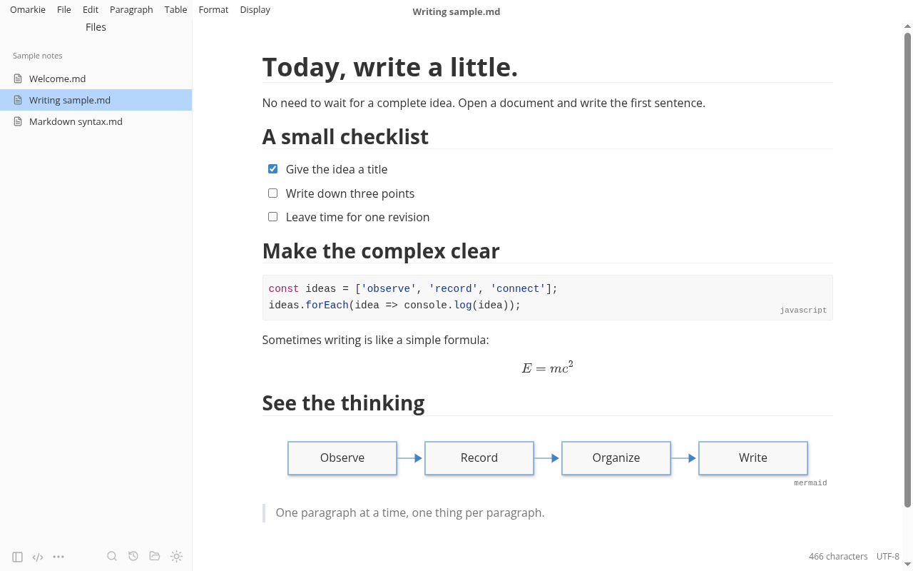
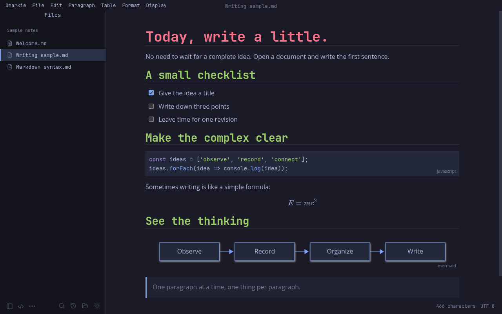
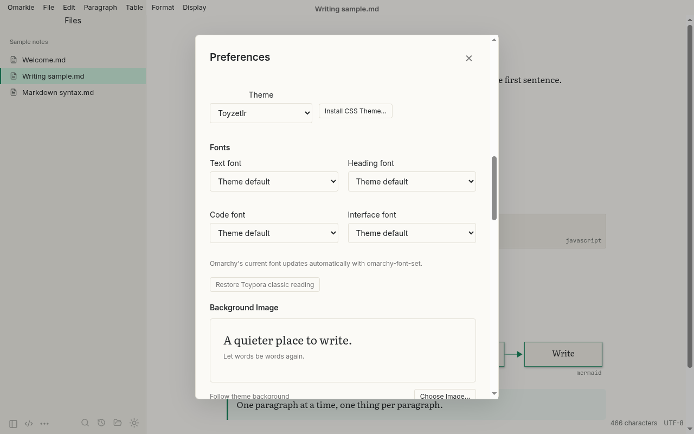

<p align="center">
  
</p>

<h1 align="center">Omarkie</h1>

<p align="center">Write in Markdown. Work directly on the page. Keep your files.</p>

<p align="center">
  <a href="https://github.com/gafgpt-cmd/omarkie/releases/latest">Download</a> · <a href="#features">Features</a> · <a href="#see-what-it-renders">See what it renders</a> · <a href="#themes-and-fonts">Themes and fonts</a> · <a href="CONTRIBUTING.md">Contributing</a> · <a href="LICENSE">MIT License</a>
</p>



Omarkie is an open-source Markdown editor with live, inline rendering. Write directly in the formatted document, switch to source when you need it, and keep ordinary `.md` files in your own folders. It feels at home on [Omarchy](https://omarchy.org): it follows your Omarchy theme and font live, and it runs on Linux, Windows and macOS.

**Status:** early development, version **0.2.3**. The interface is available in English, Spanish, Catalan, Romanian and Chinese.

**No telemetry.** Omarkie never phones home: no analytics, no crash reports, no update checks, and the spellcheck dictionaries are built in.

Every change is AI reviewed and tested before it lands, with [no-mistakes](https://github.com/kunchenguid/no-mistakes) (automated review, tests, lint and CI).

## Features

- **Live Markdown editing**: headings, inline formatting, lists, tasks, tables, links, footnotes and YAML front matter. Edit code and formulas in place, or switch to the full source view.
- **Shared undo/redo**: rich and source views keep edits in order. Switching views preserves history; each IME commit remains one step.
- **Themes and fonts**: 17 built-in themes, including Toypora, Toyzetlr and live Omarchy themes, plus pickers for the text, heading, code and interface fonts. The fonts are bundled, so documents look the same on any machine.
- **Omarchy integration**: themes follow the current Omarchy palette and font, and update while the app is open when you run `omarchy-theme-set` or `omarchy-font-set`. Under Omarchy, Omarkie uses the Omarchy theme until you choose another theme yourself.
- **A focused writing space**: menu bar, outline, focus and typewriter modes, word counts, find and replace, and personal background images.
- **Optional reading tools**: fold callouts/tables, view and resize images, adjust width, use slash commands and navigate a right outline. Fifteen offline plugins: eight community plugins plus seven focused reading ports ([compatibility scope](docs/plugins.md)).
- **Works with Typora themes and plugins**: install compatible CSS themes and local plugins.
- **Files you control**: folder tree, full-text search, quick open, recent files, autosave, session recovery and external-change conflict detection. Syncthing-style folder sync with side-by-side compare and recoverable conflict copies, plus an offline phone companion: [folder sync](docs/folder-sync.md).
- **Vault references**: Ctrl/Cmd-click wikilinks, aliases and tags; search tags; inspect linked mentions and a lazy graph. Ambiguous targets stay visible.
- **Document workflows**: generic OKF-ready new notes, lazy Properties, explicit note/folder conversion previews and copied OKF bundles. Existing notes never migrate silently.
- **Study and annotate**: preview converted-text cleanup, collect highlights and callouts, tuck scraps under paragraphs, and review spaced-repetition cards. See [Learning mode](docs/document-workflows.md#learning-mode). Glass ink follows paragraphs, table cells and list items through edits. Comment bubbles anchor to a page element, show an X-ray of what would be sent, and pin agent answers as cue cards. Glass keeps its journals beside the vault, never inside your notes: [glass storage](docs/glass-storage.md). Move a vault with the **Sync** button through a git remote you already made: [git sync](docs/git-sync.md). Turn on optional Excalidraw diagrams, off by default and fully offline: [boards](docs/boards.md). Open Obsidian `.canvas` boards and clip passages onto them: [canvas](docs/canvas.md). Margin cards embed a section, cache a Tutor answer or quiz a menu: [glass cards](docs/glass-cards.md). Pick any element and Change it — cover it on the glass or replace it in the page with a licensed picture or a Tutor rewrite: [glass swap](docs/glass-swap.md). Pin labels on a picture, hide them for an occlusion quiz, and fold the note to cues in exam mode: [glass study](docs/glass-study.md).
- **Writing output**: templates, letterheads, [Zotero and Vancouver citations](docs/document-workflows.md#vault-bibliography), and [multi-note DOCX/PDF export](docs/document-workflows.md#project-export). Also includes link/asset reports and Markdown checks.
- **Private by default**: remote media and embeds are blocked until allowed. [Payload summaries and follow-up questions](docs/document-workflows.md#payload) and [LanguageTool](#grammar-with-languagetool) are opt-in and send text only when requested.
- **Images, math and diagrams**: [standalone images that fit the reading column](docs/document-workflows.md#reading-images), local and pasted images, Obsidian-style pictures (paths with spaces, `![[picture.png]]`, `![[picture.png|300]]`, `![[picture.png|300x200]]`, found anywhere in the vault), [section embeds](docs/document-workflows.md#section-embeds) (`![[Note#Heading]]`, live and read-only), read-only [Obsidian Bases](docs/document-workflows.md#bases) (`.base` tables and cards, `![[file.base#View]]` embeds), `{width=300}` sizes and `file://` paths, offline MathJax, Mermaid and a [legacy sequence/flow subset](docs/diagrams.md). Optional uploads through a configured PicGo Server.
- **More than UTF-8**: UTF-16 LE/BE, GB18030, GBK, Big5, Shift JIS and Windows-1252. BOM and mixed line endings survive edits, transforms and undo.
- **Import and export**: HTML and PDF built in; DOCX, ODT, RTF, EPUB and more through [Pandoc](https://pandoc.org/).

## See what it renders

Five illustrated introductions ship with the app in [docs/showcase](docs/showcase).
First launch opens all five, with the travel journal active.
Saved sessions and explicitly opened files take precedence; existing users keep their notes.
**Help → Showcase Examples** opens the travel journal and shows the Showcase folder, restoring missing notes and pictures without overwriting edits.
Each note demonstrates pictures, tables, formulas or diagrams. Every screenshot below is the real app.

| | |
| --- | --- |
| [](docs/showcase/travel-journal.md) | [](docs/showcase/recipe-card.md) |
| **[Seven Days on the Lighthouse Coast](docs/showcase/travel-journal.md)**<br>Local photos, highlights, quotes, callouts, footnotes and a packing checklist. | **[Midnight Lemon Olive Oil Cake](docs/showcase/recipe-card.md)**<br>A sized photo, aligned tables, task lists, a warning box and a little kitchen maths. |
| [](docs/showcase/space-explainer.md) | [](docs/showcase/launch-plan.md) |
| **[How Far Is a Light-Year?](docs/showcase/space-explainer.md)**<br>Inline and display math with MathJax, superscripts, a Mermaid diagram and Python code. | **[The Corner Garden: Launch Plan](docs/showcase/launch-plan.md)**<br>A table of contents, a Mermaid timeline and flowchart, checklists, budgets and highlighted YAML. |
| [](docs/showcase/poetry-and-type.md) | |
| **[The Shape of Words](docs/showcase/poetry-and-type.md)**<br>Poems in type: bold, italic, strikethrough, highlights, sub and superscript, emoji. | |

The screenshots use five of the built-in themes: Toyzetlr, Toypora, Toyzetlr Night, Plain White and Warm Paper. All the art in the samples is original and drawn for this project.

## Themes and fonts

| Theme | Colors | Fonts |
| --- | --- | --- |
| **Toypora** / **Toypora Night** | Classic white page / soft night | Open Sans, 16 px, line height 1.6, 860 px column |
| **Toyzetlr** / **Toyzetlr Night** | Warm paper, green accents | Literata text, Inter headings and interface, JetBrains Mono code |
| **Omarchy (auto)** | Your live Omarchy palette | Your Omarchy font for text, headings, code and interface |
| **Omarchy colors · reading fonts** | Your live Omarchy palette | Classic reading fonts |
| **White paper · Omarchy headings** | Classic white page | Omarchy headings, Liberation Sans text |

Under **Preferences → Fonts**, choose the text, heading, code and interface fonts independently: Open Sans, PT Serif, Merriweather, Lato, Vollkorn, Literata, Inter, JetBrains Mono, Arimo, Tinos, your available Omarchy font, or the system fonts. Local-only fonts appear when they are installed. **Restore Toypora classic reading** brings back the classic set in one click.
On Electron, font and size changes survive an immediate quit. No extra Save step.

| Toypora | Omarchy | Fonts |
| --- | --- | --- |
|  |  |  |

## Install

Download the package for your platform from [Releases](https://github.com/gafgpt-cmd/omarkie/releases/latest) and check it against `SHA256SUMS.txt`.

### Linux

| Distribution | Package | Install |
| --- | --- | --- |
| Arch, Omarchy, Manjaro | `omarkie-0.2.3-1-any.pkg.tar.zst` | `sudo pacman -U ./omarkie-0.2.3-1-any.pkg.tar.zst` |
| Debian, Ubuntu, Mint | `Omarkie-0.2.3-linux-x64.deb` | `sudo apt install ./Omarkie-0.2.3-linux-x64.deb` |
| Fedora, RHEL | `omarkie-0.2.3-1.x86_64.rpm` | `sudo dnf install ./omarkie-0.2.3-1.x86_64.rpm` |
| openSUSE | `omarkie-0.2.3-1.x86_64.rpm` | `sudo zypper install ./omarkie-0.2.3-1.x86_64.rpm` |
| Any x64 distribution | `Omarkie-0.2.3-linux-x64.AppImage` | `chmod +x` the file and run it |

Release builds publish the lightweight Arch package and its SHA-256 checksum in GitHub Releases. Installing the Arch package does not install Electron, and the package does not bundle it. On launch, Omarkie looks for the versioned Electron dependency of installed Obsidian (the Omarchy default). Without installed Obsidian, it checks for the newest runnable installed `electronNN`, then checks Obsidian's pacman sync metadata. If the selected executable is missing, Omarkie offers to install or repair that series. If no supported series is found, Omarkie stops. Electron 43 or newer is required. The other packages bundle their own runtime. All packages add the launcher and the Markdown file association; removing them keeps your documents and recovery data. The AppImage may need FUSE 2; without it, run `./Omarkie-0.2.3-linux-x64.AppImage --appimage-extract` and then `./squashfs-root/AppRun`. Do not disable Chromium's sandbox to run the application.

If the selected Electron executable is missing when you launch from the desktop, Omarkie uses `xdg-terminal-exec` to open an installer terminal. After a successful install or repair, Omarkie opens the requested files even after that terminal closes. Without `xdg-terminal-exec`, run the printed install command and launch Omarkie again.

#### Update, uninstall and clean up

To update, install the new package over the old one with the same command as above. There is no need to remove the old one first. On Arch, a rebuilt package with the same version number also replaces the installed one; on Debian, Fedora and openSUSE it needs `sudo apt reinstall ./<file>.deb`, `sudo dnf reinstall ./<file>.rpm` or `sudo zypper install --force ./<file>.rpm`.

| | Arch, Omarchy, Manjaro | Debian, Ubuntu, Mint | Fedora, RHEL | openSUSE |
| --- | --- | --- | --- | --- |
| Which build is installed | `pacman -Q omarkie` | `dpkg -s omarkie` | `rpm -q omarkie` | `rpm -q omarkie` |
| Uninstall | `sudo pacman -R omarkie` | `sudo apt remove omarkie` | `sudo dnf remove omarkie` | `sudo zypper remove omarkie` |

- Matching release tag: plain version, such as `0.2.3`.
- Later Arch builds: `0.2.3.r<commits>.g<commit>`.
- Later DEB/RPM/AppImage builds: `0.2.3+r<commits>.g<commit>`.
- Without a matching tag, the build retains a reachable version tag or a hash-only fallback (`.r0.g<commit>`).
- Packaged **About** shows the build identity. All Linux artifact filenames retain the revision.

Uninstalling never touches your documents. Settings, recovery drafts, installed themes and plugins, and the background image stay in `~/.config/Omarkie`. Move that folder to the Trash to remove them as well, or to reset Omarkie to its defaults; unsaved drafts in it are lost. For the AppImage, delete the file.

### Windows

Run **Setup.exe**, choose a folder and launch Omarkie from the Start menu. The installer adds an optional desktop shortcut and Markdown file associations. The build is not code-signed yet, so Windows may show an unknown-publisher notice; only use downloads from this repository.

### macOS

Open the DMG and drag **Omarkie** into **Applications**. Requires macOS 14 or later on Apple Silicon. The app is locally signed and not notarized, so macOS may ask you to approve it in **System Settings → Privacy & Security**.

### Optional converters

Install [Pandoc](https://pandoc.org/installing.html) for DOCX, ODT, EPUB and other formats; select its executable in Preferences if it is not detected. Pandoc before 3.12.1 drops equations and table header rows from ODT, so ODT import with it goes through LibreOffice; install LibreOffice or Pandoc 3.12.1+ from its [releases](https://github.com/jgm/pandoc/releases). On Linux and Windows, legacy DOC/RTF import also needs [LibreOffice](https://www.libreoffice.org/download/download-libreoffice/).

PDFs (Linux and Windows): **Open** a `.pdf`, or pass one to `omarkie`, and Omarkie opens a Markdown copy with its pictures, made by an external PDF-to-Markdown converter and kept in the data folder (`PDF/`), so an unchanged PDF opens again without converting. The converter is called as `<converter> <file.pdf> --output <folder>` and must write a `.md` file there. Omarkie uses `OMARKIE_PDF_CONVERTER` (a path, or a JSON list such as `["python3", "/path/to/orchestrator.py"]`), else a `pdf-converter` file with the same content in the data folder, else `pdf-md` on `PATH`. Without a converter, or when it fails, Omarkie offers to open the PDF in your PDF viewer.

### Read aloud offline

- Desktop: **More actions → Read selection or paragraph**, **Read from cursor**, or **Stop reading**.
- A selection takes priority. With no selection, read the current block or from the cursor to the end. Source mode reads literal Markdown and uses blank lines to find paragraph boundaries.
- Install [eSpeak NG](https://github.com/espeak-ng/espeak-ng) separately. Example on Linux: `OMARKIE_TTS='["espeak-ng","--stdin","-b","1"]' omarkie`.
- Set `OMARKIE_TTS` before launching the app. Use one executable name/path or a JSON array of the executable and fixed arguments. No shell. The program gets UTF-8 text on stdin and must own playback in the foreground.
- Off by default. Omarkie starts only the configured program, only when asked. No speech engine is bundled. Use a trusted offline program; no eSpeak NG (GPL-3.0) code is included. The note is not edited.

## Build from source

Use **Node.js 26** and npm.

```sh
git clone https://github.com/gafgpt-cmd/omarkie.git
cd omarkie
npm ci
npm run package:linux   # DEB, RPM and AppImage in release/linux/
npm run package:arch    # Arch package on the shared Electron runtime, in release/arch/ (needs makepkg)
npm run package:win     # on Windows x64: installer and ZIP in release/windows/
npm run package:mac     # on macOS with Xcode Command Line Tools: release/native/Omarkie.app
```

## First steps

Open a Markdown file or a folder, or start from the Showcase examples (**Help → Showcase Examples**). Click the text to edit it. Enter continues a list or creates a paragraph; Tab moves through table cells.

| Action | Linux / Windows | macOS |
| --- | --- | --- |
| New document | `Ctrl+N` | `⌘N` |
| Open a file | `Ctrl+O` | `⌘O` |
| Save | `Ctrl+S` | `⌘S` |
| Preferences | `Ctrl+,` | `⌘,` |
| Toggle source view | `Ctrl+/` | `⌘/` |
| Find in the document | `Ctrl+F` | `⌘F` |
| Search the folder | `Ctrl+Shift+F` | `⌘⇧F` |
| Quick open | `Ctrl+P` | `⌘⇧O` |

### Grammar with LanguageTool

- Start the [self-hosted LanguageTool HTTP server](https://dev.languagetool.org/http-server) (LGPL-2.1). Omarkie does not bundle or start it.
- Enable **Preferences → LanguageTool grammar**. Default: `http://127.0.0.1:8081/v2/check`.
- For a non-loopback server, enter its HTTPS `/v2/check` URL and approve its exact origin. Redirects are blocked.
- Choose **Check grammar… → Send note**. Only this action sends the current Markdown (up to 20,000 characters) to the displayed endpoint. Check the server's data policy before sending sensitive text.
- Click an underline or pick a grammar finding. Choose a replacement to edit, or close to leave the note unchanged. Undo reverses the edit. Editing clears old findings.
- Desktop only. Off by default. No requests on open, edit, or enable. Separate from offline spellcheck and Markdown lint.

## Development

```sh
npm ci
npm run dev:app   # Vite + Electron
npm test          # editor and file-layer unit tests
npm run build     # type check and production build
```

Full verification: [dependencies and commands](CONTRIBUTING.md#make-a-change).

Linux and Windows use Electron; the macOS release uses a native Swift/AppKit host with WKWebView. Both share the same TypeScript/React interface and editing model. Desktop suites, packaging and the project layout are described in [CONTRIBUTING.md](CONTRIBUTING.md) and [the architecture](docs/architecture.md).

## Performance targets

Feature-release correctness uses `npm run verify`: editor, desktop, export, startup and disabled-plugin checks remain mandatory.
Strict timing is separate: `npm run test:perf` still fails any exceeded [budget](tests/perf-budgets.json). No targets or fixtures were relaxed.

Eight paired Linux/Xvfb runs, alternating order with fresh profiles. Times are median (min–max), in ms.

| Check | Target | Before | After |
| --- | ---: | ---: | ---: |
| Launch to readable note | 1000 | 1312 (1052–1822) | 1227 (1074–1878) |
| 1.5 MB note readable | 1500 | 1138 (1080–1236) | 1061 (930–1423) |
| Big-note scroll | 300 | 54 (48–63) | 39 (34–50) |
| First cold photo | 150 | 265 (252–348) | 181 (163–283) |

- Linux timing run: `flock -w 1800 /tmp/omarkie-electron.lock xvfb-run -a sh -c 'OMARKIE_TEST_DISPLAY="$DISPLAY" OMARKIE_TEST_HIDDEN=0 npm run test:perf'`.
- Launch did not improve consistently. Launch and cold photo still miss their targets on Xvfb.
- Four photos loaded within three seconds on every run. See [timing report fields](docs/architecture.md#tests).
- Stage trace: main-module evaluation was the largest launch stage. Glass storage and Git sync now load on first use: about 110 ms less import work before the window.
- Headless Ozone diagnostic after that change (5 runs, 12-core laptop, busy host): launch 720, big note 574, scroll 21, cold photo 101, warm photo 73. All pass; the Xvfb table above still needs a rerun.
- Cold photo stages (auth, queue, read, decode-to-visible): read dominates at 30–50 ms; queue stays under 10 ms.

## Current limitations

- Documents are limited to 20 MB. Files over 12,000,000 characters, or with a single block over 256,000 characters, open in source mode.
- Legacy encodings without a BOM need an explicit encoding choice.
- Format conversion can change layout. Keep the original file when importing.
- Third-party themes, plugins, input methods and image hosts vary in compatibility.

## Contributing

Bug reports, focused fixes and reproducible examples are welcome. Start with [the contribution guide](CONTRIBUTING.md), then open an [issue](https://github.com/gafgpt-cmd/omarkie/issues) or a pull request.

## License

[MIT](LICENSE). Bundled fonts (Open Sans, PT Serif, Merriweather, Lato, Vollkorn, Literata, Inter, JetBrains Mono, Arimo, Tinos) are under the SIL Open Font License; MathJax and its fonts use Apache-2.0. Third-party dependencies keep their own licenses, and the packaged application includes their notices.
