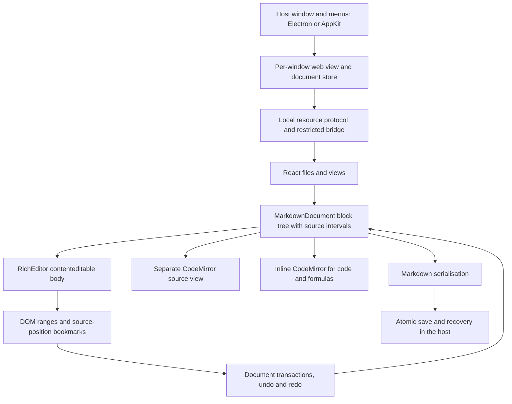

# Architecture

Linux and Windows releases use Electron/Chromium, which is also the development and regression host. The macOS release uses a native Swift/AppKit host with one WKWebView per window. Both hosts load the same TypeScript/React interface and editing model and talk to it through a narrow message bridge.

## Document model and editing

`src/editor/model.ts` holds the block nodes, the original source intervals, stable node IDs, Markdown positions and the selection. Serialisation stitches blocks and intervals back together in order, so an unedited document returns exactly the text it was read from. The host keeps the BOM; the model and the store together keep line endings, front matter and whitespace.

`RichEditor.ts` renders the body as real editable DOM. `beforeinput` turns typing, deletion and structural edits into document transactions and re-renders only the blocks that changed; unchanged blocks keep their DOM nodes. Inline syntax is recognised by markdown-it; delimiters stay in the DOM and expand only in the inline node that holds a collapsed caret. Images and formulas are rendered separately from their source, so caret positions never depend on rendered text length. Large documents render in windows with spacers and an LRU block cache.

Input-method composition pauses re-rendering of the affected DOM. On commit the edited leaf receives a minimal diff, container prefixes of multi-line quotes and lists are kept, and the change is one undo step. Mode switches wait for composition to finish. Cross-block replacement, paragraph merge and split, task toggles and table edits all go through the same transaction layer.

The source view is a separate CodeMirror instance that reads the model's source and sends changes back through the same transactions; code blocks and formulas use inline CodeMirror editors. Rich text and code blocks share one history. Source mode keeps its own history and joins the rich history as a single transaction when you return; selections survive the switch through bookmarks.

MathJax 4 (SVG output with bundled New Computer Modern fonts) and Mermaid load on demand. Export waits for formulas, diagrams and fonts before producing HTML or PDF.

## Commands and extensions

`shared/commands.json` defines every menu item, shortcut and front-end command once: `key` holds the macOS binding and `pcKey` the Linux/Windows binding. On Linux the native menu bar is hidden and `src/components/MenuBar.tsx` renders the same commands inside the window, so the theme also styles the menus; clipboard roles run in the main process. `blockCommands.ts` converts paragraphs on source lines while keeping container prefixes and the selection, one history transaction per action.

`markdownExtensions.ts` maps the table of contents, footnotes, front matter, comments and restricted HTML back to source positions. Turning an extension off re-renders without rewriting the file. Pasting prefers the app's own Markdown type, then sanitised HTML converted to Markdown. `legacyDiagrams.ts` translates the supported legacy sequence/flow syntax to Mermaid for rendering only ([diagrams.md](diagrams.md)).

## Themes, fonts and Omarchy

`src/themes.ts` applies one theme stylesheet at a time. Classic and Toypora themes live in `toyporaTheme.ts`, Toyzetlr in `toyzetlrTheme.ts`, and the Omarchy family in `omarchyTheme.ts`. Each theme sets CSS variables for colors and for the document (`--document-font`) and interface (`--chrome-font`) faces. `src/fonts.ts` adds the user's font choices as a second stylesheet whose selectors outrank any theme; `src/fontFaces.ts` bundles the font files.

On Linux, `electron/omarchy.mjs` reads `~/.local/state/omarchy/current/theme/colors.toml` (accepting only flat hex values) and the current monospace family from fontconfig. It watches the theme directory and `~/.config/fontconfig/fonts.conf`, so `omarchy-theme-set` and `omarchy-font-set` restyle open windows. Imported CSS themes have their `#write`, `#typora-sidebar` and `.md-fences` selectors mapped onto Omarkie's own.

## Files, windows and privacy

Each window has its own web view, document store, model and session file. Opening a file that is already open focuses its window. The front end only passes document IDs; the host tracks which files each record may touch. Saves write a sibling temporary file, flush it, compare the on-disk hash again and rename atomically; an external change keeps the draft and reports a conflict. The resource protocol serves relative and absolute images and media for open documents only, honours a YAML root, and refuses symbolic links and oversized resources.

The bridge only accepts the main frame of the local app origin. Remote images, media and embeds are off by default: the renderer strips remote attributes and, in Electron, `webRequest` cancels every non-loopback request from the window until the user allows remote images. Sanitised HTML drops scripts, event handlers and forged editor attributes.

`electron/workspace.mjs` (and `native/Workspace.swift`) manage folder tokens, recent items, full-text search, copy/rename/move/Trash and a one-step undo for file operations. Image moves copy everything first and only then move originals to the Trash.

## Encodings and conversion

Unicode is detected from the BOM; other encodings are chosen explicitly. Before saving, every code point is checked to round-trip, so a lossy save never touches the file. Pandoc handles DOCX, ODT, EPUB and other formats, with a local Lua filter for HTML blocks; Mermaid diagrams become PNGs in the converted copy only. Legacy DOC/RTF go through LibreOffice to DOCX first on Linux and Windows; macOS can also use `textutil`.

## Plugins

Plugins are CommonJS modules compiled without `eval`. The host provides lifecycle and document events, owned timers, tracked DOM helpers, hotkeys and undoable edits, and unloads everything a plugin owns when it is disabled or fails. Details and limits are in [plugins.md](plugins.md).

## Tests

- `npm test`: editor kernel, file layer, themes, fonts and translations.
- `npm run test:desktop`, `test:parity`, `test:background-desktop`: Electron editing, saving, images, export and recovery.
- `npm run test:kernel-desktop`, `test:features`, `test:alignment`, `test:encoding`: desktop interaction suites (macOS key bindings).
- `npm run test:native`, `npm run test:webkit`: Swift file layer and WebKit integration on macOS.

Automated composition checks do not replace manual input-method testing.
