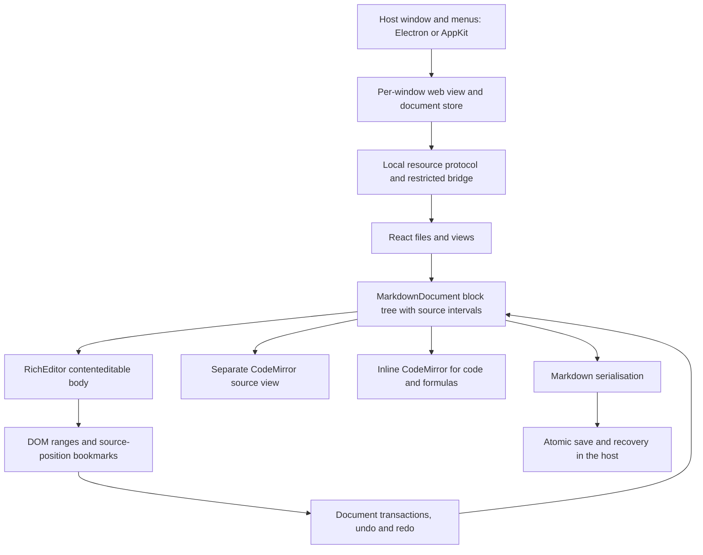

# Architecture

Linux and Windows releases use Electron/Chromium, which is also the development and regression host. The macOS release uses a native Swift/AppKit host with one WKWebView per window. Both hosts load the same TypeScript/React interface and editing model and talk to it through a narrow message bridge.

## Document model and editing

`src/editor/model.ts` holds the block nodes, the original source intervals, stable node IDs, Markdown positions and the selection. Serialisation stitches blocks and intervals back together in order, so an unedited document returns exactly the text it was read from. The host keeps the BOM; the model and the store together keep line endings, front matter and whitespace.

`RichEditor.ts` renders the body as real editable DOM. `beforeinput` turns typing, deletion and structural edits into document transactions and re-renders only the blocks that changed; unchanged blocks keep their DOM nodes. Inline syntax is recognised by markdown-it; delimiters stay in the DOM and expand only in the inline node that holds a collapsed caret. Images and formulas are rendered separately from their source, so caret positions never depend on rendered text length. Large documents render in windows with spacers and an LRU block cache.

Input-method composition pauses re-rendering of the affected DOM. On commit the edited leaf receives a minimal diff, container prefixes of multi-line quotes and lists are kept, and the change is one undo step. Mode switches wait for composition to finish. Cross-block replacement, paragraph merge and split, task toggles and table edits all go through the same transaction layer.

- Source view and inline code/formula editors use separate CodeMirror instances, but share `MarkdownDocument` history with rich text.
- Switching views closes the typing group, not the history. Bookmarks retain selections.
- Transactions retain original line-ending spans alongside normalized editor text; transforms and undo preserve mixed endings.

MathJax 4 (SVG output with bundled New Computer Modern fonts) and Mermaid load on demand. Export waits for formulas, diagrams and fonts before producing HTML or PDF.

## Commands and extensions

`shared/commands.json` defines every menu item, shortcut and front-end command once: `key` holds the macOS binding and `pcKey` the Linux/Windows binding. On Linux the native menu bar is hidden and `src/components/MenuBar.tsx` renders the same commands inside the window, so the theme also styles the menus; clipboard roles run in the main process. `blockCommands.ts` converts paragraphs on source lines while keeping container prefixes and the selection, one history transaction per action.

- `shared/markdown.mjs` configures the parser; `document-syntax.mjs`, `math-syntax.mjs` and `wiki-syntax.mjs` own syntax rules.
- `shared/parser-context.mjs` maps parser-recognized contexts back to original source offsets, including table escapes, block prefixes and line endings. Reference indexing and image extraction use it.
- `src/editor/markdownExtensions.ts` supplies document rendering rules. Disabling a syntax option re-renders without rewriting the file.
- Pasting prefers the app's own Markdown type, then sanitised HTML converted to Markdown.
- `legacyDiagrams.ts` translates the supported legacy sequence/flow syntax to Mermaid for rendering only ([diagrams.md](diagrams.md)).

## Themes, fonts and Omarchy

`src/themes.ts` applies one theme stylesheet at a time. Classic and Toypora themes live in `toyporaTheme.ts`, Toyzetlr in `toyzetlrTheme.ts`, and the Omarchy family in `omarchyTheme.ts`. Each theme sets CSS variables for colors and for the document (`--document-font`) and interface (`--chrome-font`) faces. `src/fonts.ts` adds the user's font choices as a second stylesheet whose selectors outrank any theme; `src/fontFaces.ts` bundles the font files.

On Linux, `electron/omarchy.mjs` reads `~/.local/state/omarchy/current/theme/colors.toml` (accepting only flat hex values) and the current monospace family from fontconfig. It watches the theme directory and `~/.config/fontconfig/fonts.conf`, so `omarchy-theme-set` and `omarchy-font-set` restyle open windows. Imported CSS themes have their `#write`, `#typora-sidebar` and `.md-fences` selectors mapped onto Omarkie's own.

## Files, windows and privacy

Each window has its own web view, document store, model and session file. Opening a file that is already open focuses its window. The front end only passes document IDs; the host tracks which files each record may touch. Saves write a sibling temporary file, flush it, compare the on-disk hash again and rename atomically; an external change keeps the draft and reports a conflict. The document resource protocol serves relative and absolute media for document IDs the host still holds open. It honours a YAML root and refuses symbolic links and oversized resources.

macOS local media grants:

- Successful saved-note opens mark the grant pending in the window store. Drafts are not marked pending.
- A renderer snapshot that omits a pending ID keeps the grant in memory without adding the note to that recovery snapshot.
- Saving a renderer snapshot with the ID clears pending status. Saving an explicit close removes the grant.
- Opening a closed note from the file tree gives it a fresh ID. Reopening from history uses the live ID if the note is already open.

The bridge only accepts the main frame of the local app origin. Sanitised HTML drops scripts, event handlers and forged editor attributes. When remote media is off, the renderer filters remote resources.

- Electron blocks HTTP(S) and WebSocket requests from the app window, including loopback, except for the Vite origin in development. This filter does not cover host-side requests.
- macOS uses a WebKit content rule list for offline views and project PDF rendering. It blocks HTTP(S), WS(S) and FTP(S), not local schemes. CSP and HTML sanitisation still apply; `data:` and `blob:` media support does not grant navigation permission.

Spellcheck languages are stored with editor preferences and validated against Electron’s available languages before applying them to the default session. Bundled en-US, es-ES, ca and ro-RO `.bdic` dictionaries are seeded into the profile, and the dictionary download URL points at the app's own local dictionaries folder. Other languages find nothing there and simply have no spellcheck; no Google dictionary host is contacted. System Hunspell `.aff`/`.dic` files in `/usr/share/hunspell` are not Chromium `.bdic` dictionaries and cannot be used directly. macOS uses the system spellchecker and its language settings.

Packagers stamp the [build identity](../README.md#update-uninstall-and-clean-up) into the packaged HTML metadata for About; unpackaged builds show `dev`.

Electron vault search reads one file at a time (8 MiB per file, 512 MiB total), yields between files, and keeps the 5-second deadline and 500-result cap.

`electron/workspace.mjs` (and `native/Workspace.swift`) manage folder tokens, recent items, full-text search, copy/rename/move/Trash and a one-step undo for file operations. Image moves copy everything first and only then move originals to the Trash.

Rename, move and their undo use OS no-replace operations. Destination collisions preserve both items and leave draft paths unchanged.

## Encodings and conversion

Unicode is detected from the BOM; other encodings are chosen explicitly. Before saving, every code point is checked to round-trip, so a lossy save never touches the file. Pandoc handles DOCX, ODT, EPUB and other formats, with a local Lua filter for HTML blocks; Mermaid diagrams become PNGs in the converted copy only. Legacy DOC/RTF, and ODT when Pandoc is older than 3.12.1 (it drops equations and table header rows), go through LibreOffice to DOCX first on Linux and Windows; macOS can also use `textutil`.

## Plugins

Plugins are CommonJS modules compiled without `eval`. The host provides lifecycle and document events, owned timers, tracked DOM helpers, hotkeys and undoable edits, and unloads everything a plugin owns when it is disabled or fails. Details and limits are in [plugins.md](plugins.md).

## Tests

- `npm test`: editor kernel, file layer, themes, fonts and translations.
- Required compatibility checks and contribution rules: [CONTRIBUTING.md](../CONTRIBUTING.md#make-a-change).
- `npm run test:desktop`, `test:parity`, `test:background-desktop`: Electron editing, saving, images, export and recovery.
- `npm run test:kernel-desktop`, `test:features`, `test:alignment`, `test:encoding`: desktop interaction suites (scope per suite: CONTRIBUTING.md).
- `node tests/menu-desktop.mjs --font-restart-only`: repeat just the strict quit/relaunch font and size regression.
- `npm run test:native`, `npm run test:webkit`: Swift file layer and WebKit integration on macOS.

**Speed checks.** After `npm run build`, use the [timing command and release policy](../README.md#performance-targets).
- `tests/perf-desktop.mjs` creates fresh synthetic fixtures and isolated profiles under `test-results/` each run.
- Results: `test-results/perf/perf-results.json`; `OMARKIE_QA_DIR` overrides the output directory.
- Reports include every sample plus median, p95, min and max per metric, and the runtime: Electron/Chromium/Node, OS, CPU, cores, memory, load average, device pixel ratio, screen and display type.
- Photo samples report `naturalSize` (density-corrected browser dimensions, not decoded pixel counts), `loadedAfter3s` (loaded-image count) and `photoStages`: auth, queue, read and decode-to-visible for the first visible photo.
- `firstPhotoWarm` relaunches the cold run's profile once its preview cache holds a photo. Reported, not budgeted.
- `launchStages`: ms after the launch request for each `OMARKIE_TRACE_STARTUP=1` mark (main process and renderer).
- `OMARKIE_PERF_HEADLESS=1` runs Linux timing on headless Ozone without an X display, for stage diagnosis. The report records `display: headless`; budgets still apply.
- Budgets: [`tests/perf-budgets.json`](../tests/perf-budgets.json). Exceeded budgets fail; no report-only bypass.
- Glass: the 50,000-note unit test checks searchable results and heartbeat progress. Only `test:perf` enforces the 400 ms main-thread gap budget.
- On a 60 Hz display, drawing ink and dragging arrows must miss no refreshes: no gap above 25 ms, and p95 at most 17.5 ms. The hover check measures handler CPU time, not display intervals.
- `OMARKIE_PERF_RUNS` sets repetitions (default 3).
- `OMARKIE_EXECUTABLE`, with optional `OMARKIE_APP`, targets an installed executable/asar for the UI timings. Glass indexing measures the checked-out code.

Automated composition checks do not replace manual input-method testing.
