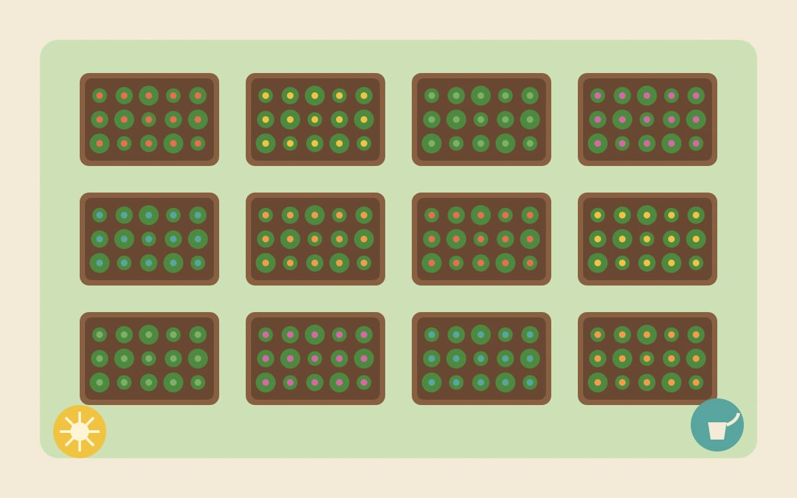
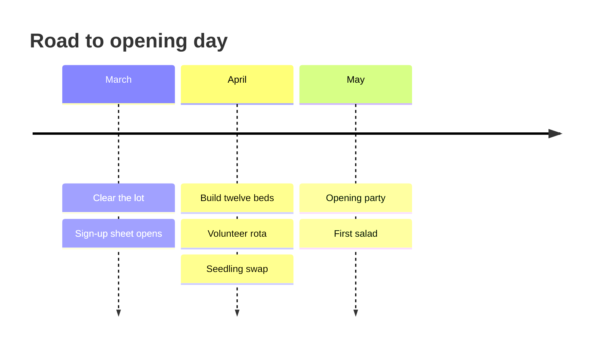

# The Corner Garden: Launch Plan :seedling:

**Twelve raised beds. One empty lot. A whole street of new neighbours.**



[TOC]

*This list of headings builds itself from the page. Add one anywhere with **Paragraph → Table of Contents**.*

## The idea

We are turning the empty lot on the corner into a shared vegetable garden. Anyone on the street can claim a bed, grow what they like and swap the extras. This page is our plan, our checklist and our memory, all in one Markdown file.

> [!NOTE]
> This is a living document. Tick boxes as you finish things and add your name next to anything you pick up.

> [!TIP]
> The box at the very top of this file is YAML front matter: a few labelled facts about the page. **Paragraph → YAML Front Matter** adds one to any note.

## Milestones



## This week

- [x] Get written permission from the city
- [x] Collect 40 pallets for the bed frames
- [x] Order soil and compost (12 m^3^)
- [ ] Fix the water tap by the gate
- [ ] Paint the welcome sign
- [ ] Find someone with a van for Saturday :truck:

## Who does what

| Team | Lead | People | Status |
| :--- | :--- | :----: | -----: |
| Building | Marta | 6 | 60 % |
| Planting | Joe | 9 | 25 % |
| Water and tools | Aisha | 3 | 80 % |
| Opening party | Li | 5 | 10 % |

## Budget

| Item | Cost | Paid by |
| :--- | ---: | :------ |
| Soil and compost | 420 | City grant |
| Screws, hinges, paint | 85 | Donations |
| Water hose and timer | 60 | Donations |
| Seeds | 0 | Seed swap :tada: |
| **Total** | **565** | |

All amounts in euros. We are ==under budget== so far.

> [!TIP]
> Lost in a big folder? **Ctrl+F** (**⌘F**) finds words on this page, **Ctrl+Shift+F** (**⌘⇧F**) searches every note in the folder, and **Ctrl+P** (**⌘⇧O**) opens a file by name.

## How a bed gets claimed


## Watering rota

The timer runs on this little config file. Anyone can edit it.

```yaml
garden: corner-garden
timer:
  days: [mon, wed, fri, sun]
  start: "06:30"
  minutes: 20
skip_if_rain_mm: 5
```

## Risks

> [!CAUTION]
> Slugs. Lots of slugs. Bring copper tape and patience.

- ~~Not enough volunteers~~ We have 23 people signed up!
- A dry May. The rota above is our plan B.
- Pigeons eating seedlings. Netting is on the shopping list.

---

*Questions? Knock on number 14, or leave a note in the box by the gate.* :mailbox_with_mail:

Need to share the plan? **File → Export PDF…** or **File → Export HTML…** makes a copy anyone can open.
