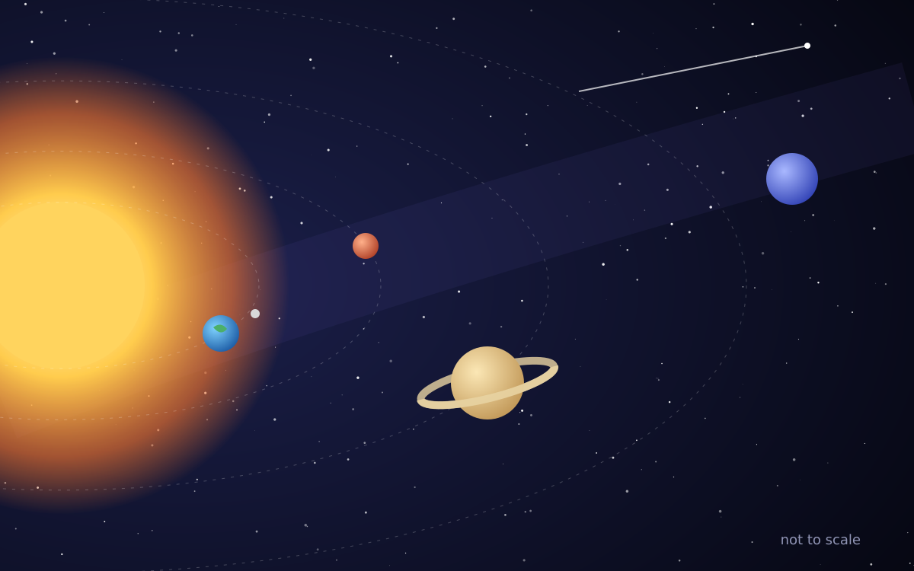
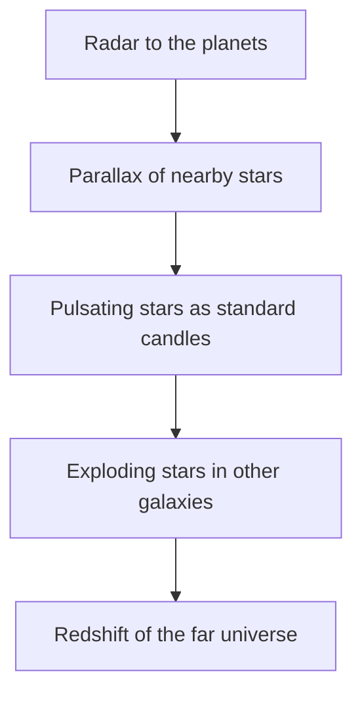

# How Far Is a Light-Year? :milky_way:

*A small tour of very big numbers, with formulas, a diagram and a picture of our neighbourhood.*



## Light is fast. Space is bigger.

Light travels at about $c \approx 3 \times 10^8$ metres per second. That is fast enough to go around the Earth **seven and a half times** in one second.

A light-year is simply how far light goes in one year:

$$
1\ \text{ly} = c \times t = 299\,792\,458\ \tfrac{\text{m}}{\text{s}} \times 31\,557\,600\ \text{s} \approx 9.46 \times 10^{15}\ \text{m}
$$

That is about **9.5 trillion kilometres**. If you drove a car at 100 km/h without stopping, you would need roughly ==10 million years== to cover one light-year. :red_car:

## How long does sunlight take to reach us?

The Sun is about 150 million km away. Divide distance by speed:

$$
t = \frac{d}{c} = \frac{1.5 \times 10^{11}\ \text{m}}{3 \times 10^{8}\ \text{m/s}} = 500\ \text{s} \approx 8.3\ \text{minutes}
$$

So when you look at the Sun (please don't), you see it as it was *eight minutes ago*.

| Object | Distance | Light travel time |
| :----- | -------: | ----------------: |
| The Moon | 384,400 km | 1.3 seconds |
| The Sun | 150 million km | 8.3 minutes |
| Neptune | 4.5 billion km | 4.2 hours |
| Proxima Centauri | 4.24 ly | 4.24 years |
| Andromeda Galaxy | 2.5 million ly | 2.5 million years |

## The cosmic distance ladder

Astronomers measure far things by building on near things. Each rung checks the next one.



## Parallax: the thumb trick

Hold up your thumb and close one eye, then the other. Your thumb jumps. Stars do the same as the Earth moves around the Sun. The size of the jump, the angle $p$, gives the distance:

$$
d\,[\text{parsec}] = \frac{1}{p\,[\text{arcsecond}]}
$$

One parsec is about 3.26 light-years[^parsec].

## Try it yourself

A few lines of Python are enough to check the numbers above:

```python
SPEED_OF_LIGHT = 299_792_458          # metres per second
SECONDS_PER_YEAR = 365.25 * 24 * 3600

light_year = SPEED_OF_LIGHT * SECONDS_PER_YEAR
print(f"One light-year is {light_year:.3e} metres")

sun = 1.496e11                        # metres
print(f"Sunlight takes {sun / SPEED_OF_LIGHT / 60:.1f} minutes")
```

## Fun facts to share at dinner

- The light from some stars you see tonight left them before the pyramids were built.
- Einstein's famous $E = mc^2$ uses the same $c$. Squared, it is about 9 × 10^16^ m^2^/s^2^.
- Water on Mars? We have found frozen H~2~O near its poles. :ice_cube:
- ~~Pluto is a planet~~ Pluto is a dwarf planet, and it is doing fine.

> [!IMPORTANT]
> Every formula on this page is plain text in the file, between dollar signs. Omarkie renders it with MathJax, fully offline.

[^parsec]: The name comes from **par**allax of one arc**sec**ond. Astronomers like short words.
