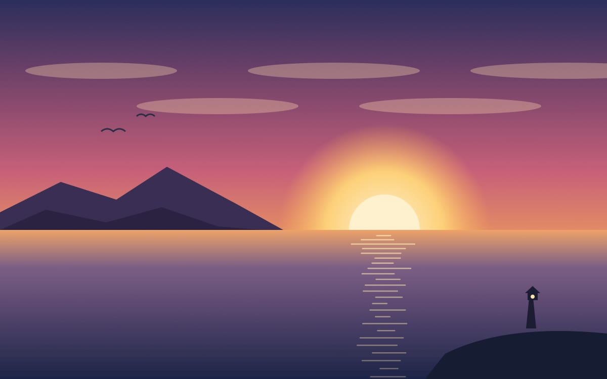
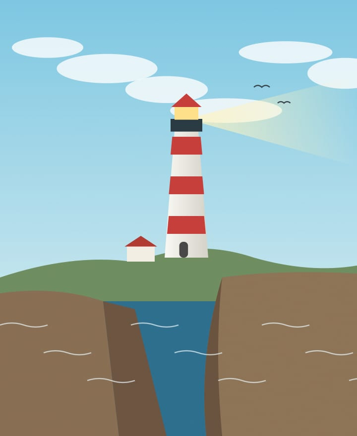
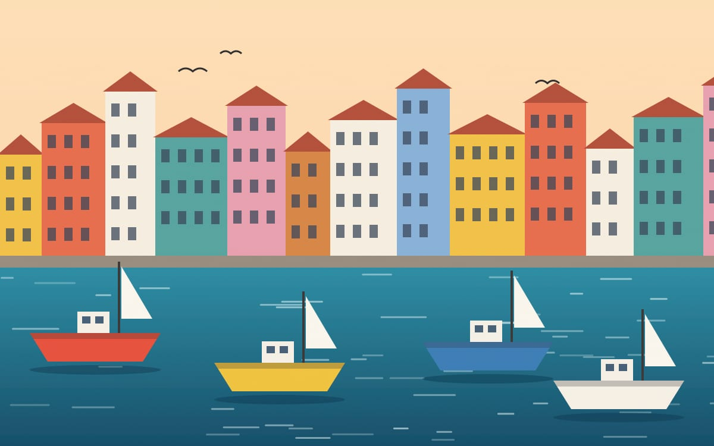
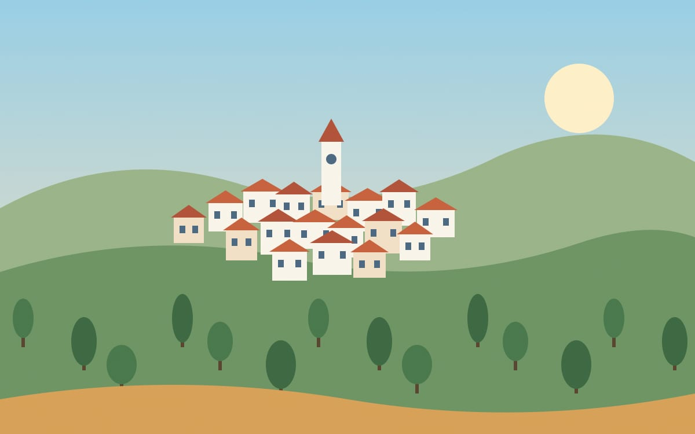

# Seven Days on the Lighthouse Coast :sunrise_over_mountains:

*A travel journal with real pictures in it. Open this file in Omarkie and the pictures sit right on the page, next to the words they belong to.*

## Day 1: Arriving before the sun

The night train rolled in at 5:40. I walked down to the water with a coffee in one hand and my bag in the other. The sky went from **ink blue** to *peach* to ==pure gold== in about twelve minutes.

> I came for the lighthouses. I stayed for the light.

Nobody else was on the beach. Just me, two gulls, and a fisherman who nodded once and went back to his lines.

## Day 2: The red and white tower

The path to the lighthouse is 4.2 km of cliff top, wild thyme and wind. The keeper's cottage is now a tiny museum[^museum]. The tower has **132 steps**. I counted twice. :footprints:

> [!TIP]
> Go in the late afternoon. The beam turns on at dusk, and you get the whole coastline glowing below you.

## Day 3: Harbour colours

Every house in the old port is painted a different colour. A local told me it started so sailors could spot *their own* home from the sea. True or not, it is a lovely story.

What I ate today:

- Grilled sardines with lemon :fish:
- ~~One~~ Two scoops of fig ice cream :icecream:
- Bread so fresh it was still warm

## Day 4: Up to the hill village

A slow bus climbs to the village every two hours. From the church square you can see three lighthouses at once on a clear day.

## The route at a glance

| Day | Place | Distance | Highlight |
| :-- | :---- | -------: | :-------: |
| 1 | Bay of the Sun | 3 km | :sunrise: |
| 2 | Cliff lighthouse | 8.4 km | :tokyo_tower: |
| 3 | Old harbour | 5 km | :sailboat: |
| 4 | Hill village | 11 km | :church: |
| 5 to 7 | Wherever the bus goes | ? | :sparkles: |

## Packing list

- [x] Good walking shoes
- [x] A notebook, and this Markdown file
- [x] Rain jacket (used it once, glad I had it)
- [ ] A bigger memory card next time
- [ ] Learn more than three words of the local language

## Why this journal is a Markdown file

Many Markdown apps show a broken icon or just a file name where a photo should be. Omarkie shows the **actual picture**, from the folder next to your note. The photos live in `images/`, the words live here, and both stay on your own computer.

> [!NOTE]
> Pictures from the internet are blocked until you allow them. Your own photos always show up. Nothing is uploaded anywhere.

[^museum]: Open Thursday to Sunday. Entry is free, but there is a jar for donations, and the volunteers make very good tea.
